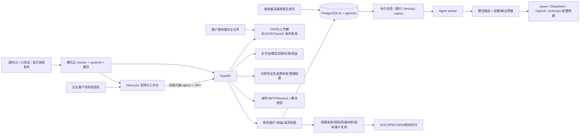

# 工程架构与代码质量

审计窗口：2026-10-29 至 2026-10-30，Asia/Shanghai。源码基线 `5458be37b50cca47f38e3f6219f5cefe5c9450af`，分支feature/investor-grade-upgrade。起始工作树干净；本轮只创建审计文档与证据，没有修改业务代码或部署。所谓委员会为多职责审查视角，不代表独立员工、认证机构或外部专家签字。

证据等级：E=本轮实测；C=代码确认未完成真实供应商验证；H=历史发布/恢复记录（未在本轮重做）；U=未验证。测试通过不等于生产完整闭环。最新线上只读样本2026-10-29 23:40:46；10月30日另测六个实验室样本。生产包版本SSH复核受已知主机文件缺失限制，未降低主机身份校验或读取凭据。


模型供应商、OSS、发票与支付是否配置及可交付不能从这张依赖图推断已验收；政策原文与上传文件是数据，不是Agent高权限指令。无额外微服务、独立消息队列或第三方认证替换证据。


## 已确认

- 服务端主要为模块化单体，SQLAlchemy事务、Alembic迁移、pgvector检索；后台任务复用数据库持久状态与租约，没有必要性证据支持拆微服务。
- 干净隔离库迁移到0034并通过alembic check；252测试覆盖订单金额/回调/权限、配额、Agent取消与fencing、证据变更和复核失效。
- 请求/订单/反馈有不同幂等策略；不可据某一实现推断所有端点均幂等。材料评论/建议有并发控制，旧报告PDF路径仍绕过固定产物内容。
- 前端类型检查、6单测、构建、Ruff通过；81.4%语句覆盖不是分支或状态空间覆盖。
- CI包含Linux/PostgreSQL16、静态/测试/构建门禁；deploy.yml为候选验证打包，显式说明不是生产激活许可。本轮未读取远端最新运行状态。
- 构建在/private/tmp独立源码副本执行；初次node_modules符号链接越出Turbopack根而失败，复制依赖后通过，是环境隔离问题，不是业务编译缺陷。

## 主要问题

DEL-01/COM-01是已实测的产物建模/就绪断点，不能因代码结构清楚而降级。ENG-01历史五项schema差异仍需有版本化例外；本轮干净库通过不代表生产漂移清零。OPS-02启动模式告警不会单独被判核心故障，但增加部署认知成本。

重复/旧路径：applications/artifacts的版本复核与tasks/report动态重算并存；商品目录与订阅Plan/Price两套契约同时存在。建议先统一状态与交付边界，再按真实收益整理；本轮没有重构或删除入口。

## 已执行命令

```
APP_ENV=test DATABASE_URL=<专用localhost *_test> YANCE_TEST_DATABASE_ACK=<同名> .venv/bin/alembic upgrade head
.venv/bin/pytest --cov=app --cov-report=json:../audits/product-acceptance/evidence/coverage.json
.venv/bin/alembic check
.venv/bin/ruff check app tests
npm run build
npm run typecheck
npm run test:unit
```

测试环境为macOS/Python3.12.13/PostgreSQL18/Node26.8.1/Next16.4.3/Playwright1.63；本轮未声称Linux生产兼容新跑通过。源码产物、部署时b408a53、当前文档HEAD5458be3分别记录，不混淆。
