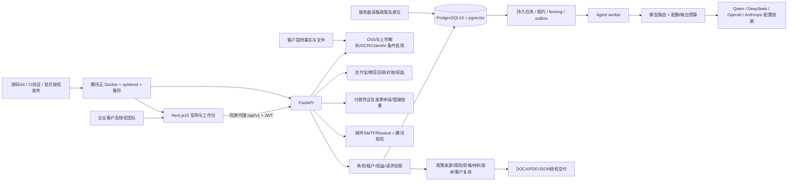

# 功能与架构清单

审计窗口：2026-10-29 至 2026-10-30，Asia/Shanghai。源码基线 `5458be37b50cca47f38e3f6219f5cefe5c9450af`，分支feature/investor-grade-upgrade。起始工作树干净；本轮只创建审计文档与证据，没有修改业务代码或部署。所谓委员会为多职责审查视角，不代表独立员工、认证机构或外部专家签字。

证据等级：E=本轮实测；C=代码确认未完成真实供应商验证；H=历史发布/恢复记录（未在本轮重做）；U=未验证。测试通过不等于生产完整闭环。最新线上只读样本2026-10-29 23:40:46；10月30日另测六个实验室样本。生产包版本SSH复核受已知主机文件缺失限制，未降低主机身份校验或读取凭据。

模型供应商、OSS、发票与支付是否配置及可交付不能从这张依赖图推断已验收；政策原文与上传文件是数据，不是Agent高权限指令。无额外微服务、独立消息队列或第三方认证替换证据。

|模块|页面→API→模型/任务→交付|判断与证据|
|---|---|---|
|官网/场景|/、about、parks→公开目录→政策/园区展示|E公开页面可见；场景标示例，园区库存/真实合作未核验|
|邮箱/手机身份|login、settings→auth/register/login/email/sms/me/logout→User/Tenant/Membership/SmsCode|E隔离注册、绑定、撤销反例；线上入口GET可见；真实短信送达仅历史用户确认，不重发|
|企业资料|companies及详情/onboarding→companies/profile/publish→Company/Profile/Version|E后端及合成项目fixture；真实企业事实由客户提供|
|政策发现|discover/policies/opportunities/company-match→policy search/scans→Policy/Source/Version/Rule/Scan→AgentRun|E规则、上下文和租户反例；真实采集完整率/向量召回U|
|资格矩阵/项目|applications及详情/projects→workflow/applications→Requirement/Evidence/Artifact/Review|E客户批准、来源变化失效、版本、DOCX授权下载；非政府资格认定|
|补证/协作|项目任务、评论、建议→workflow→gap/comment/suggestion|E权限、并发、建议过期、评论；非实时协同编辑|
|Agent执行|agents及run/tasks→agents/tasks→Run/Step/Event/Lease/Deliverable|E合成超时/取消/fencing/重试；真实模型故障与费用U|
|文件知识库|documents/policy-knowledge-base→documents→OSS/parse/chunk/ingestion|E解析/上传/SSRF/PDF安全反例；真实OSS与OCR业务样本U|
|报告交付|reports/brief-maker/tasks→reports/download、tasks/download|部分；DEL-01和COM-01已复现；自由生成报告production503为有意安全禁用|
|订单/支付|pricing/checkout/orders/success/cancel→products/orders/payments→Order/Payment/Event/Entitlement|E模拟回调、幂等和隔离；仅POLICY_REPORT可新购；未完成商品服务端停售；真实沙箱U|
|订阅与开票|billing→billing/invoices→Plan/Price/Subscription/Invoice|部分；399/999草案不是已验收可售订阅；付款凭证/正式税票分开；真实续费/退款/税票U|
|团队/设置|team/settings→tenant/users/enterprise→Membership/ApiKey/Retention/DeletionRequest|E多角色/Key限制、导出契约；保留/删除执行worker缺失；SSO/MFA/SCIM缺失|
|反馈/支持|feedback/admin→feedback→Feedback/status|E提交丢响应幂等、入库和管理处理；不自动公开评价|
|后台/评测|admin/investor-metrics/admin/evals→admin/analytics/evaluations|E管理员拒绝/合成指标/61例评测；真实漏斗和留存效果U|
|演示/旧入口|demo/roadshow/consultant/chrome-extension/downloads|C存在演示与规划入口；不能当真客户数据、真实原生客户端或已验证资源服务|

## 覆盖口径

46个page.tsx全部建索引；163个路由装饰器声明（不是所有HTTP操作均已执行），79个ORM模型、82个服务文件已扫描。构建输出42个路由是框架输出口径，与源码页面数不等价。公开10页面+15工作区路由+动态项目详情，约26/46路由形态有本轮运行接触（56.5%），其中部分仅导航外壳，不能当全部功能通过。

## 页面索引

|路由|文件|状态|
|---|---|---|
|`/about`|`website/app/about/page.tsx`|C路由确认；深层状态以模块表/浏览器证据为准|
|`/admin/evals/[runId]`|`website/app/admin/evals/[runId]/page.tsx`|C路由确认；深层状态以模块表/浏览器证据为准|
|`/admin/evals`|`website/app/admin/evals/page.tsx`|C路由确认；深层状态以模块表/浏览器证据为准|
|`/admin/investor-metrics`|`website/app/admin/investor-metrics/page.tsx`|C路由确认；深层状态以模块表/浏览器证据为准|
|`/admin`|`website/app/admin/page.tsx`|C路由确认；深层状态以模块表/浏览器证据为准|
|`/agents/[runId]`|`website/app/agents/[runId]/page.tsx`|C路由确认；深层状态以模块表/浏览器证据为准|
|`/agents`|`website/app/agents/page.tsx`|C路由确认；深层状态以模块表/浏览器证据为准|
|`/applications/[applicationId]`|`website/app/applications/[applicationId]/page.tsx`|C路由确认；深层状态以模块表/浏览器证据为准|
|`/applications`|`website/app/applications/page.tsx`|C路由确认；深层状态以模块表/浏览器证据为准|
|`/billing`|`website/app/billing/page.tsx`|C路由确认；深层状态以模块表/浏览器证据为准|
|`/brief-maker`|`website/app/brief-maker/page.tsx`|C路由确认；深层状态以模块表/浏览器证据为准|
|`/cancel`|`website/app/cancel/page.tsx`|C路由确认；深层状态以模块表/浏览器证据为准|
|`/checkout`|`website/app/checkout/page.tsx`|C路由确认；深层状态以模块表/浏览器证据为准|
|`/chrome-extension`|`website/app/chrome-extension/page.tsx`|C路由确认；深层状态以模块表/浏览器证据为准|
|`/companies/[companyId]`|`website/app/companies/[companyId]/page.tsx`|C路由确认；深层状态以模块表/浏览器证据为准|
|`/companies`|`website/app/companies/page.tsx`|C路由确认；深层状态以模块表/浏览器证据为准|
|`/company-match`|`website/app/company-match/page.tsx`|C路由确认；深层状态以模块表/浏览器证据为准|
|`/consultant`|`website/app/consultant/page.tsx`|C路由确认；深层状态以模块表/浏览器证据为准|
|`/dashboard`|`website/app/dashboard/page.tsx`|C路由确认；深层状态以模块表/浏览器证据为准|
|`/demo`|`website/app/demo/page.tsx`|C路由确认；深层状态以模块表/浏览器证据为准|
|`/discover`|`website/app/discover/page.tsx`|C路由确认；深层状态以模块表/浏览器证据为准|
|`/documents`|`website/app/documents/page.tsx`|C路由确认；深层状态以模块表/浏览器证据为准|
|`/downloads`|`website/app/downloads/page.tsx`|C路由确认；深层状态以模块表/浏览器证据为准|
|`/feedback`|`website/app/feedback/page.tsx`|C路由确认；深层状态以模块表/浏览器证据为准|
|`/login`|`website/app/login/page.tsx`|C路由确认；深层状态以模块表/浏览器证据为准|
|`/notifications`|`website/app/notifications/page.tsx`|C路由确认；深层状态以模块表/浏览器证据为准|
|`/onboarding`|`website/app/onboarding/page.tsx`|C路由确认；深层状态以模块表/浏览器证据为准|
|`/opportunities/[opportunityId]`|`website/app/opportunities/[opportunityId]/page.tsx`|C路由确认；深层状态以模块表/浏览器证据为准|
|`/opportunities`|`website/app/opportunities/page.tsx`|C路由确认；深层状态以模块表/浏览器证据为准|
|`/orders`|`website/app/orders/page.tsx`|C路由确认；深层状态以模块表/浏览器证据为准|
|`/.`|`website/app/page.tsx`|C路由确认；深层状态以模块表/浏览器证据为准|
|`/parks`|`website/app/parks/page.tsx`|C路由确认；深层状态以模块表/浏览器证据为准|
|`/policies`|`website/app/policies/page.tsx`|C路由确认；深层状态以模块表/浏览器证据为准|
|`/policy-knowledge-base`|`website/app/policy-knowledge-base/page.tsx`|C路由确认；深层状态以模块表/浏览器证据为准|
|`/pricing`|`website/app/pricing/page.tsx`|C路由确认；深层状态以模块表/浏览器证据为准|
|`/privacy`|`website/app/privacy/page.tsx`|C路由确认；深层状态以模块表/浏览器证据为准|
|`/projects`|`website/app/projects/page.tsx`|C路由确认；深层状态以模块表/浏览器证据为准|
|`/reports`|`website/app/reports/page.tsx`|C路由确认；深层状态以模块表/浏览器证据为准|
|`/roadshow`|`website/app/roadshow/page.tsx`|C路由确认；深层状态以模块表/浏览器证据为准|
|`/security`|`website/app/security/page.tsx`|C路由确认；深层状态以模块表/浏览器证据为准|
|`/settings`|`website/app/settings/page.tsx`|C路由确认；深层状态以模块表/浏览器证据为准|
|`/success`|`website/app/success/page.tsx`|C路由确认；深层状态以模块表/浏览器证据为准|
|`/tasks/[taskId]`|`website/app/tasks/[taskId]/page.tsx`|C路由确认；深层状态以模块表/浏览器证据为准|
|`/tasks`|`website/app/tasks/page.tsx`|C路由确认；深层状态以模块表/浏览器证据为准|
|`/team`|`website/app/team/page.tsx`|C路由确认；深层状态以模块表/浏览器证据为准|
|`/terms`|`website/app/terms/page.tsx`|C路由确认；深层状态以模块表/浏览器证据为准|

## API声明索引

路径按APIRouter静态prefix和/api/v1解析；条件挂载和权限仍须阅读处理函数。

|方法/路径|处理函数|文件与行|
|---|---|---|
|GET `/api/v1/admin/overview`|admin.get_admin_overview|yance-ai/app/api/routes/admin.py:119|
|GET `/api/v1/admin/investor-metrics`|admin.get_investor_metrics|yance-ai/app/api/routes/admin.py:127|
|GET `/api/v1/admin/system-health`|admin.get_system_health|yance-ai/app/api/routes/admin.py:135|
|GET `/api/v1/admin/resources/{resource}`|admin.list_admin_resources|yance-ai/app/api/routes/admin.py:143|
|PATCH `/api/v1/admin/organizations/{tenant_id}`|admin.update_tenant_account_stage|yance-ai/app/api/routes/admin.py:396|
|PATCH `/api/v1/admin/feedback/{feedback_id}`|admin.update_feedback_status|yance-ai/app/api/routes/admin.py:411|
|GET `/api/v1/admin/feature-flags`|admin.list_feature_flags|yance-ai/app/api/routes/admin.py:432|
|PUT `/api/v1/admin/feature-flags/{key}`|admin.upsert_feature_flag|yance-ai/app/api/routes/admin.py:458|
|PUT `/api/v1/admin/feature-flags/{key}/tenants/{tenant_id}`|admin.set_tenant_feature_flag|yance-ai/app/api/routes/admin.py:492|
|DELETE `/api/v1/admin/feature-flags/{key}/tenants/{tenant_id}`|admin.remove_tenant_feature_flag|yance-ai/app/api/routes/admin.py:542|
|GET `/api/v1/admin/invoices`|admin.admin_list_invoices|yance-ai/app/api/routes/admin.py:638|
|POST `/api/v1/admin/invoices/{invoice_id}/issue`|admin.admin_issue_invoice|yance-ai/app/api/routes/admin.py:664|
|POST `/api/v1/admin/invoices/{invoice_id}/reject`|admin.admin_reject_invoice|yance-ai/app/api/routes/admin.py:705|
|GET `/api/v1/admin/evals/overview`|admin_evals.get_evaluation_overview|yance-ai/app/api/routes/admin_evals.py:52|
|GET `/api/v1/admin/evals/runs`|admin_evals.list_evaluation_runs|yance-ai/app/api/routes/admin_evals.py:61|
|POST `/api/v1/admin/evals/runs`|admin_evals.create_evaluation_runs|yance-ai/app/api/routes/admin_evals.py:72|
|GET `/api/v1/admin/evals/runs/{run_id}`|admin_evals.get_evaluation_run|yance-ai/app/api/routes/admin_evals.py:99|
|POST `/api/v1/agent-runs/{run_id}/cancel`|agents.cancel_agent_run|yance-ai/app/api/routes/agents.py:32|
|GET `/api/v1/agents`|agents.list_agents|yance-ai/app/api/routes/agents.py:211|
|GET `/api/v1/agent-runs`|agents.list_agent_runs|yance-ai/app/api/routes/agents.py:266|
|GET `/api/v1/agent-runs/{run_id}`|agents.get_agent_run|yance-ai/app/api/routes/agents.py:285|
|GET `/api/v1/feedback`|analytics.list_my_feedback|yance-ai/app/api/routes/analytics.py:26|
|POST `/api/v1/feedback`|analytics.create_feedback|yance-ai/app/api/routes/analytics.py:45|
|POST `/api/v1/auth/bootstrap`|auth.bootstrap|yance-ai/app/api/routes/auth.py:107|
|POST `/api/v1/auth/provision-tenant`|auth.provision_tenant|yance-ai/app/api/routes/auth.py:120|
|POST `/api/v1/auth/register`|auth.register|yance-ai/app/api/routes/auth.py:132|
|POST `/api/v1/auth/login`|auth.login|yance-ai/app/api/routes/auth.py:233|
|GET `/api/v1/auth/config`|auth.auth_config|yance-ai/app/api/routes/auth.py:305|
|POST `/api/v1/auth/email/send`|auth.email_code_send|yance-ai/app/api/routes/auth.py:320|
|POST `/api/v1/auth/email/verify`|auth.email_code_verify|yance-ai/app/api/routes/auth.py:354|
|POST `/api/v1/auth/password/reset/request`|auth.password_reset_request|yance-ai/app/api/routes/auth.py:509|
|POST `/api/v1/auth/password/reset/confirm`|auth.password_reset_confirm|yance-ai/app/api/routes/auth.py:544|
|GET `/api/v1/auth/me`|auth.me|yance-ai/app/api/routes/auth.py:603|
|POST `/api/v1/auth/logout`|auth.logout|yance-ai/app/api/routes/auth.py:608|
|GET `/api/v1/billing/plans`|billing.get_plans|yance-ai/app/api/routes/billing.py:35|
|GET `/api/v1/billing/overview`|billing.get_billing_overview|yance-ai/app/api/routes/billing.py:40|
|POST `/api/v1/billing/budgets`|billing.upsert_budget|yance-ai/app/api/routes/billing.py:123|
|GET `/api/v1/orders`|commerce.list_orders|yance-ai/app/api/routes/commerce.py:37|
|POST `/api/v1/orders`|commerce.create_order|yance-ai/app/api/routes/commerce.py:44|
|POST `/api/v1/payments`|commerce.create_payment_skeleton|yance-ai/app/api/routes/commerce.py:126|
|POST `/api/v1/invoices`|commerce.create_invoice|yance-ai/app/api/routes/commerce.py:138|
|POST `/api/v1/invoices/{invoice_id}/generate-pdf`|commerce.generate_invoice|yance-ai/app/api/routes/commerce.py:200|
|GET `/api/v1/invoices/{invoice_id}/download`|commerce.download_invoice|yance-ai/app/api/routes/commerce.py:229|
|GET `/api/v1/invoices/{invoice_id}/voucher`|commerce.download_invoice_voucher|yance-ai/app/api/routes/commerce.py:256|
|GET `/api/v1/invoices`|commerce.list_invoices|yance-ai/app/api/routes/commerce.py:290|
|GET `/api/v1/companies`|companies.list_companies|yance-ai/app/api/routes/companies.py:30|
|POST `/api/v1/companies`|companies.create_company|yance-ai/app/api/routes/companies.py:37|
|GET `/api/v1/companies/{company_id}`|companies.get_company|yance-ai/app/api/routes/companies.py:73|
|PUT `/api/v1/companies/{company_id}`|companies.update_company|yance-ai/app/api/routes/companies.py:82|
|GET `/api/v1/companies/{company_id}/profile`|companies.get_company_profile|yance-ai/app/api/routes/companies.py:97|
|PUT `/api/v1/companies/{company_id}/profile`|companies.update_company_profile|yance-ai/app/api/routes/companies.py:110|
|POST `/api/v1/companies/{company_id}/profile/publish`|companies.publish_profile|yance-ai/app/api/routes/companies.py:133|
|GET `/api/v1/companies/{company_id}/profile/versions`|companies.list_profile_versions|yance-ai/app/api/routes/companies.py:159|
|DELETE `/api/v1/companies/{company_id}`|companies.delete_company|yance-ai/app/api/routes/companies.py:178|
|GET `/api/v1/demo/scenarios`|demo.list_demo_scenarios|yance-ai/app/api/routes/demo.py:63|
|GET `/api/v1/demo/scenarios/{key}`|demo.get_demo_scenario|yance-ai/app/api/routes/demo.py:85|
|GET `/api/v1/demo/scenarios/{key}/artifacts/{artifact_id}/download`|demo.download_demo_artifact|yance-ai/app/api/routes/demo.py:309|
|POST `/api/v1/reports/match`|demo_match.generate_match_report|yance-ai/app/api/routes/demo_match.py:82|
|GET `/api/v1/reports/{company_id}/download`|demo_match.download_match_report_pdf|yance-ai/app/api/routes/demo_match.py:182|
|GET `/api/v1/products`|demo_match.get_products|yance-ai/app/api/routes/demo_match.py:239|
|POST `/api/v1/payments/demo-pay`|demo_match.demo_payment|yance-ai/app/api/routes/demo_match.py:269|
|GET `/api/v1/entitlements`|demo_match.get_entitlements|yance-ai/app/api/routes/demo_match.py:378|
|GET `/api/v1/analytics/stats`|demo_match.get_analytics_stats|yance-ai/app/api/routes/demo_match.py:408|
|GET `/api/v1/documents`|documents.list_documents|yance-ai/app/api/routes/documents.py:70|
|POST `/api/v1/documents/url`|documents.import_document_url|yance-ai/app/api/routes/documents.py:93|
|GET `/api/v1/documents/{document_id}`|documents.get_document|yance-ai/app/api/routes/documents.py:236|
|POST `/api/v1/documents/presign-upload`|documents.presign_upload|yance-ai/app/api/routes/documents.py:245|
|POST `/api/v1/documents/{document_id}/complete`|documents.complete_upload|yance-ai/app/api/routes/documents.py:293|
|POST `/api/v1/documents/{document_id}/ingest`|documents.ingest_document|yance-ai/app/api/routes/documents.py:334|
|POST `/api/v1/documents/{document_id}/facts/review`|documents.review_document_facts|yance-ai/app/api/routes/documents.py:376|
|GET `/api/v1/enterprise/api-keys`|enterprise.list_api_keys|yance-ai/app/api/routes/enterprise.py:77|
|POST `/api/v1/enterprise/api-keys`|enterprise.issue_api_key|yance-ai/app/api/routes/enterprise.py:83|
|POST `/api/v1/enterprise/api-keys/{key_id}/revoke`|enterprise.revoke_api_key|yance-ai/app/api/routes/enterprise.py:91|
|GET `/api/v1/enterprise/retention`|enterprise.get_retention|yance-ai/app/api/routes/enterprise.py:103|
|PUT `/api/v1/enterprise/retention`|enterprise.update_retention|yance-ai/app/api/routes/enterprise.py:110|
|GET `/api/v1/enterprise/exports`|enterprise.list_exports|yance-ai/app/api/routes/enterprise.py:121|
|POST `/api/v1/enterprise/exports`|enterprise.create_export|yance-ai/app/api/routes/enterprise.py:127|
|GET `/api/v1/enterprise/exports/{job_id}/download`|enterprise.download_export|yance-ai/app/api/routes/enterprise.py:135|
|GET `/api/v1/enterprise/deletion-request`|enterprise.get_deletion_request|yance-ai/app/api/routes/enterprise.py:143|
|POST `/api/v1/enterprise/deletion-request`|enterprise.schedule_deletion|yance-ai/app/api/routes/enterprise.py:149|
|POST `/api/v1/enterprise/deletion-request/{request_id}/cancel`|enterprise.cancel_deletion|yance-ai/app/api/routes/enterprise.py:165|
|GET `/api/v1/enterprise/feature-flags`|enterprise.get_feature_flags|yance-ai/app/api/routes/enterprise.py:177|
|GET `/api/v1/enterprise/audit-logs`|enterprise.list_audit_logs|yance-ai/app/api/routes/enterprise.py:182|
|GET `/api/v1/notifications`|funding_os.list_notifications|yance-ai/app/api/routes/funding_os.py:97|
|GET `/api/v1/notifications/unread-count`|funding_os.unread_count|yance-ai/app/api/routes/funding_os.py:110|
|POST `/api/v1/notifications/scan`|funding_os.trigger_deadline_scan|yance-ai/app/api/routes/funding_os.py:126|
|POST `/api/v1/notifications/{notification_id}/read`|funding_os.mark_read|yance-ai/app/api/routes/funding_os.py:135|
|POST `/api/v1/notifications/read-all`|funding_os.mark_all_read|yance-ai/app/api/routes/funding_os.py:155|
|POST `/api/v1/consultant/ask`|funding_os.ask_consultant|yance-ai/app/api/routes/funding_os.py:173|
|GET `/api/v1/funding/summary`|funding_os.funding_summary|yance-ai/app/api/routes/funding_os.py:187|
|GET `/api/v1/applications/{application_id}/milestones`|funding_os.list_milestones|yance-ai/app/api/routes/funding_os.py:324|
|POST `/api/v1/applications/{application_id}/milestones`|funding_os.create_milestone|yance-ai/app/api/routes/funding_os.py:350|
|PATCH `/api/v1/milestones/{milestone_id}`|funding_os.update_milestone|yance-ai/app/api/routes/funding_os.py:379|
|DELETE `/api/v1/milestones/{milestone_id}`|funding_os.delete_milestone|yance-ai/app/api/routes/funding_os.py:408|
|GET `/api/v1/health`|health.health|yance-ai/app/api/routes/health.py:12|
|GET `/api/v1/health/ready`|health.readiness|yance-ai/app/api/routes/health.py:17|
|POST `/api/v1/payments/alipay/page-pay`|payments.alipay_page_pay|yance-ai/app/api/routes/payments.py:147|
|POST `/api/v1/payments/alipay/notify`|payments.alipay_notify|yance-ai/app/api/routes/payments.py:221|
|POST `/api/v1/payments/alipay/return`|payments.alipay_return|yance-ai/app/api/routes/payments.py:289|
|POST `/api/v1/payments/wechat/native`|payments.wechat_native|yance-ai/app/api/routes/payments.py:332|
|POST `/api/v1/payments/wechat/notify`|payments.wechat_notify|yance-ai/app/api/routes/payments.py:384|
|POST `/api/v1/payments/wechat/query`|payments.wechat_query|yance-ai/app/api/routes/payments.py:448|
|POST `/api/v1/payments/checkout`|payments.create_checkout_session|yance-ai/app/api/routes/payments.py:490|
|POST `/api/v1/payments/webhook`|payments.stripe_webhook|yance-ai/app/api/routes/payments.py:554|
|GET `/api/v1/bank/info`|payments.get_bank_info|yance-ai/app/api/routes/payments.py:622|
|POST `/api/v1/bank/orders/{order_id}/receipt`|payments.upload_bank_receipt|yance-ai/app/api/routes/payments.py:648|
|POST `/api/v1/bank/payments/{payment_id}/verify`|payments.verify_bank_transfer|yance-ai/app/api/routes/payments.py:659|
|GET `/api/v1/policies`|policies.list_policies|yance-ai/app/api/routes/policies.py:41|
|POST `/api/v1/policies`|policies.create_policy|yance-ai/app/api/routes/policies.py:48|
|GET `/api/v1/policies/{policy_id}`|policies.get_policy|yance-ai/app/api/routes/policies.py:63|
|PUT `/api/v1/policies/{policy_id}`|policies.update_policy|yance-ai/app/api/routes/policies.py:80|
|POST `/api/v1/test-embed`|policies.test_embed|yance-ai/app/api/routes/policies.py:101|
|POST `/api/v1/policies/search`|policies.search_policies|yance-ai/app/api/routes/policies.py:114|
|GET `/api/v1/policy-rules`|policies.list_policy_rules|yance-ai/app/api/routes/policies.py:137|
|POST `/api/v1/policy-rules`|policies.create_policy_rule|yance-ai/app/api/routes/policies.py:146|
|GET `/api/v1/eligibility-rules`|policies.list_eligibility_rules|yance-ai/app/api/routes/policies.py:167|
|POST `/api/v1/eligibility-rules`|policies.create_eligibility_rule|yance-ai/app/api/routes/policies.py:191|
|POST `/api/v1/required-materials`|policies.create_required_material|yance-ai/app/api/routes/policies.py:250|
|POST `/api/v1/policy-benefits`|policies.create_policy_benefit|yance-ai/app/api/routes/policies.py:274|
|POST `/api/v1/policies/parse-amounts`|policies.parse_support_amounts|yance-ai/app/api/routes/policies.py:298|
|POST `/api/v1/policy-engine/evaluate`|policy_engine.evaluate|yance-ai/app/api/routes/policy_engine.py:29|
|POST `/api/v1/reports/generate`|reports.generate_report|yance-ai/app/api/routes/reports.py:34|
|POST `/api/v1/auth/sms/send`|sms_auth.send|yance-ai/app/api/routes/sms_auth.py:134|
|POST `/api/v1/auth/sms/verify`|sms_auth.verify|yance-ai/app/api/routes/sms_auth.py:139|
|POST `/api/v1/auth/sms/bind/send`|sms_auth.bind_send|yance-ai/app/api/routes/sms_auth.py:218|
|POST `/api/v1/auth/sms/bind`|sms_auth.bind|yance-ai/app/api/routes/sms_auth.py:228|
|POST `/api/v1/tasks`|tasks.create_task|yance-ai/app/api/routes/tasks.py:55|
|GET `/api/v1/tasks`|tasks.list_tasks|yance-ai/app/api/routes/tasks.py:72|
|GET `/api/v1/tasks/{task_id}`|tasks.get_task|yance-ai/app/api/routes/tasks.py:95|
|POST `/api/v1/tasks/{task_id}/execute`|tasks.execute_task|yance-ai/app/api/routes/tasks.py:176|
|POST `/api/v1/tasks/{task_id}/pay`|tasks.pay_task|yance-ai/app/api/routes/tasks.py:205|
|POST `/api/v1/tasks/{task_id}/revision`|tasks.request_revision|yance-ai/app/api/routes/tasks.py:252|
|POST `/api/v1/tasks/{task_id}/accept`|tasks.accept_task|yance-ai/app/api/routes/tasks.py:285|
|GET `/api/v1/tasks/{task_id}/download`|tasks.download_pdf|yance-ai/app/api/routes/tasks.py:308|
|GET `/api/v1/tasks/{task_id}/next-actions`|tasks.next_best_actions|yance-ai/app/api/routes/tasks.py:358|
|GET `/api/v1/tasks/admin/all`|tasks.admin_tasks|yance-ai/app/api/routes/tasks.py:407|
|POST `/api/v1/analytics/events`|telemetry.capture_event|yance-ai/app/api/routes/telemetry.py:14|
|POST `/api/v1/agent-runs`|telemetry.start_agent_run|yance-ai/app/api/routes/telemetry.py:26|
|PATCH `/api/v1/agent-runs/{run_id}`|telemetry.finish_agent_run|yance-ai/app/api/routes/telemetry.py:38|
|GET `/api/v1/tenant`|tenants.current_tenant|yance-ai/app/api/routes/tenants.py:17|
|GET `/api/v1/users`|tenants.list_users|yance-ai/app/api/routes/tenants.py:27|
|POST `/api/v1/users`|tenants.create_user|yance-ai/app/api/routes/tenants.py:35|
|GET `/api/v1/policy-scans`|workflow.list_policy_scans|yance-ai/app/api/routes/workflow.py:134|
|POST `/api/v1/policy-scans`|workflow.create_policy_scan|yance-ai/app/api/routes/workflow.py:146|
|GET `/api/v1/policy-scans/{scan_id}`|workflow.get_policy_scan|yance-ai/app/api/routes/workflow.py:275|
|GET `/api/v1/opportunities`|workflow.list_opportunities|yance-ai/app/api/routes/workflow.py:284|
|POST `/api/v1/opportunities`|workflow.create_opportunity_disabled|yance-ai/app/api/routes/workflow.py:301|
|GET `/api/v1/opportunities/{opportunity_id}`|workflow.get_opportunity|yance-ai/app/api/routes/workflow.py:311|
|POST `/api/v1/opportunities/{opportunity_id}/opened`|workflow.record_opportunity_opened|yance-ai/app/api/routes/workflow.py:432|
|GET `/api/v1/applications`|workflow.list_applications|yance-ai/app/api/routes/workflow.py:461|
|POST `/api/v1/applications`|workflow.create_application|yance-ai/app/api/routes/workflow.py:474|
|GET `/api/v1/applications/{application_id}`|workflow.get_application|yance-ai/app/api/routes/workflow.py:634|
|PATCH `/api/v1/applications/{application_id}`|workflow.update_application|yance-ai/app/api/routes/workflow.py:798|
|PATCH `/api/v1/applications/{application_id}/status`|workflow.update_application_status|yance-ai/app/api/routes/workflow.py:825|
|PATCH `/api/v1/applications/{application_id}/requirements/{requirement_id}`|workflow.update_requirement_status|yance-ai/app/api/routes/workflow.py:940|
|POST `/api/v1/applications/{application_id}/documents`|workflow.link_application_document|yance-ai/app/api/routes/workflow.py:977|
|POST `/api/v1/applications/{application_id}/comments`|workflow.create_application_comment|yance-ai/app/api/routes/workflow.py:1046|
|POST `/api/v1/applications/{application_id}/agent-actions`|workflow.application_agent_action|yance-ai/app/api/routes/workflow.py:1160|
|POST `/api/v1/applications/{application_id}/artifacts/{artifact_id}/review`|workflow.review_application_artifact|yance-ai/app/api/routes/workflow.py:1307|
|POST `/api/v1/applications/{application_id}/artifacts/{artifact_id}/edit`|workflow.edit_application_artifact|yance-ai/app/api/routes/workflow.py:1391|
|GET `/api/v1/applications/{application_id}/artifacts/{artifact_id}/download`|workflow.download_application_artifact|yance-ai/app/api/routes/workflow.py:1459|
|POST `/api/v1/applications/{application_id}/evidence-tasks`|workflow.create_evidence_tasks|yance-ai/app/api/routes/workflow.py:1495|
|POST `/api/v1/applications/{application_id}/comments/{comment_id}/decision`|workflow.decide_application_suggestion|yance-ai/app/api/routes/workflow.py:1558|

## 模型索引

Tenant→tenants, DemoScenario→demo_scenarios, User→users, Membership→memberships, Company→companies, CompanyProfile→company_profiles, CompanyProfileVersion→company_profile_versions, CompanyFact→company_facts, Document→documents, DocumentIngestionRun→document_ingestion_runs, DocumentContent→document_contents, DocumentChunk→document_chunks, DocumentFactCandidate→document_fact_candidates, Policy→policies, PolicyRule→policy_rules, PolicyVersion→policy_versions, PolicyChunk→policy_chunks, EligibilityRule→eligibility_rules, RequiredMaterial→required_materials, PolicyBenefit→policy_benefits, PolicyScan→policy_scans, Opportunity→opportunities, EligibilityResult→eligibility_results, Evidence→evidence, Application→applications, ApplicationRequirement→application_requirements, ApplicationActivity→application_activities, ApplicationDocumentLink→application_document_links, ApplicationArtifact→application_artifacts, ApplicationComment→application_comments, Order→orders, Payment→payments, PaymentEvent→payment_events, Invoice→invoices, AnalyticsEvent→analytics_events, Feedback→feedback, EvalDataset→eval_datasets, EvalDatasetVersion→eval_dataset_versions, EvalCase→eval_cases, EvalRun→eval_runs, Evaluation→evaluations, EvaluationDimensionScore→evaluation_dimension_scores, EvaluationEvidence→evaluation_evidence, EvaluationError→evaluation_errors, Plan→plans, PriceVersion→price_versions, Subscription→subscriptions, SubscriptionItem→subscription_items, UsageMeter→usage_meters, UsageRecord→usage_records, UsageBudget→usage_budgets, ApiKey→api_keys, RetentionPolicy→retention_policies, ExportJob→export_jobs, DeletionRequest→deletion_requests, FeatureFlag→feature_flags, TenantFeatureFlag→tenant_feature_flags, Product→products, Entitlement→entitlements, Agent→agents, Workflow→workflows, WorkflowRun→workflow_runs, AgentRun→agent_runs, AgentStep→agent_steps, ToolCall→tool_calls, AgentRunError→agent_run_errors, AgentRetry→agent_retries, Artifact→artifacts, AuditLog→audit_logs, Task→tasks, Deliverable→deliverables, RevisionRequest→revision_requests, Notification→notifications, Milestone→milestones, EmailCode→email_codes, AuthRateLimit→auth_rate_limit, NotificationDelivery→notification_deliveries, LLMInvocation→llm_invocations, SmsCode→sms_codes
