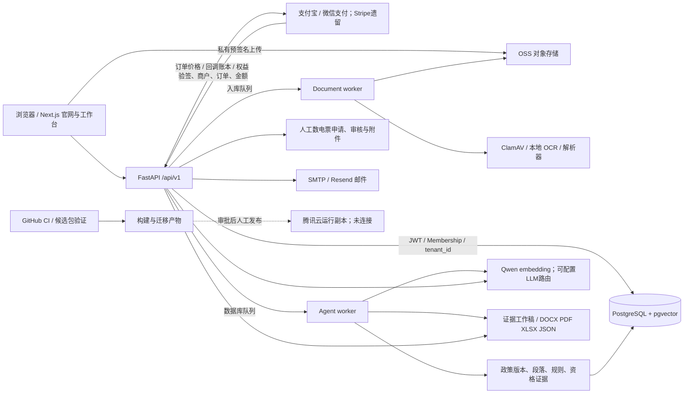

# 衍策引擎 AI 证据审计

> 2026-10-24 V2第九批：文本模型租户日调用/输出预留已实现；235项回归及6项边界复验通过，迁移0032未生产发布。非金额计费，未覆盖向量化。见[验收范围与回退](v2-model-budget-report-20261024.md)。

> 2026-10-24 V2第八批：当前成员角色与工作台只读交互已修复；229项后端与1项真实隔离API浏览器通过，无新增迁移、未生产发布。见[验收与回退](v2-workspace-roles-report-20261024.md)。

> 2026-10-23 V2第七批：评论/建议创建去重与响应丢失重试已在本地验收；228项后端与1项合成浏览器测试通过，兼容迁移0031未生产发布。见[报告与回退](v2-comment-idempotency-report-20261023.md)。

> 2026-10-23 V2第六批：补齐无来源就绪替身的合成政策API链路、引用篡改与额度回滚/恢复反例；完整226项通过。只加测试，无产品/迁移改动，生产未变更。见[验收边界](v2-suggestion-evidence-report-20261023.md)。

> 2026-10-23 V2第五批：人工摘要建议接受/拒绝已实现本地合同验收，222项后端回归与1项合成浏览器测试通过，迁移0030未生产发布。真实来源建议全链路仍待验收，见[报告及回退](v2-summary-suggestions-report-20261023.md)。

> 2026-10-23 V2第四批：版本级批注与审计关联已实现，221项后端回归及1项合成浏览器用例通过；新增兼容迁移0029，未生产发布。见[本批验收与回退](v2-version-comments-report-20261023.md)。

> 2026-10-23 V2第三批：工作稿版本对比已在本地实现，4项算法测试与1项合成浏览器合同测试通过，无后端/迁移改动，未生产发布。见[本批报告](v2-comparison-report-20261023.md)。

> 2026-10-23 V2第二批：任务租约隔离、按收件人的截止提醒outbox与停机处理已完成本地验证；220项回归通过，新增迁移0028，未生产发布。见[实现与验收](v2-reliability-report-20261023.md)、[运维与回退](v2-reliability-runbook-20261023.md)。以下第一批/旧发布记录保留其原时间边界。

> 2026-10-23 V2第一批：本批证据审计与代码差距见[实现与验收](v2-first-batch-report-20261023.md)和[差距映射](v2-gap-map-20261023.md)。本批只在本地与隔离环境验证，未生产发布；以下保留历史批次记录。

> 2026-10-21正式更新：后端e58a7c4及数据库0027已获授权上线，迁移后76张业务表原字段摘要一致；公开域名验收通过。见[后端发布记录](backend-release-20261021.md)。以下保留10月20日的审计时间点观察和未验证边界，不代表当前仍未部署。

> 22:16更新：用户确认后，已独立发布网页 `ab50458` 到正式域名。后端整批审计修复仍在本地，未部署；下文“未连接生产/未部署”描述的是较早的隔离审计阶段。网页部署与公开验收的最新证据见 [网页发布记录](website-release-20261020.md)。原source-manifest是早期审计快照，不代表最终网页版本。

## 范围、版本和证据边界

日期：2026-10-20，Asia/Shanghai。唯一开发目录 `/Users/shajindi/yance-backup/yance/`；基线 `a31f157e7fe789237ed1b5dc276388b1aaad0e71`，分支 `feature/investor-grade-upgrade`，开始时 `git status --short` 为空。基线之后的改动全部是本轮本地改造。候选代码指纹见 `audit-evidence/source-manifest.json`。没有读取生产环境秘密、客户资料或历史交易，没有连接生产服务器，没有生产部署、真实交易或对外申报。GitHub 当前远端 HEAD、生产文件版本与实际云端配置没有核实。

已先读根 README、website/AGENTS.md、后端 README、CI、Compose、生产运行、恢复及回滚文档。没有发现根 AGENTS.md；前端按已安装 Next.js 本地文档执行，并用 React 检查指引复核组件。

证据等级：

- **已实测确认**：本轮本地程序执行、隔离 PostgreSQL、Chromium 或公开 HTTP 文本观察；须同时写明环境，不能外推生产。
- **代码确认但未运行**：静态可追踪的实现，缺目标环境执行证据。
- **官网自述但未核实**：页面上的生产能力承诺，不等于实际业务验收。
- **待验证**：尚无足够代码、配置或执行证据。
- **检查工具受限**：抓取失败、浏览器连接超时、Docker 未启动等，不能直接归因为产品故障。

完整执行结果见 [test-report.md](test-report.md)。本轮已实现多批 P0 和部分 P1，未宣称全部 P1/P2 已完成。

## 官网复核与能力声明

公开读取时间：2026-10-20。观察的是公开文本，不进行生产注册、登录、支付或扫描任务。

|URL|本轮证据|结论等级及限制|
|---|---|---|
|[首页](https://yance.ai/)|明确标注虚构报告、测试数据截图及开发中功能；同时有“已上线”“每条结论附原文”等声明|文本存在已实测；实际服务完成能力仍为官网自述，不能由演示认定|
|[政策库介绍](https://yance.ai/policy-knowledge-base)|页面明确写明规模尚未公开，数量/更新频率/结构化覆盖率待统计，展示样例标记 DEMO|已实测文本；真实库存、更新 SLA、真实召回待验证|
|[安全页](https://yance.ai/security)|列出认证、租户边界、签名结算等自述，并披露独立渗透、MFA/SSO、灾备承诺等缺口|已实测文本；部署控制、供应商合同与真实安全表现待验证|
|[登录](https://yance.ai/login)|文本抓取仅有加载中|不能判定浏览器故障；本地真实 Chromium 已通过登录/注销|
|[定价](https://yance.ai/pricing)、[工作台](https://yance.ai/dashboard)|本轮 web 工具无法访问；CUA 打开/读取登录 tab 两次超时|检查工具受限；不认定授权绕过或生产加载失败。本地定价可正常水合，工作台受 API 鉴权|
|公共页脚|“申报助手”原指向价格页，“产业研究”原指向政策库，“企业画像”原指向介绍页|公开文本与源码共同确认；本地已改名/改链，生产文本未变|

公开能力原文只作核对线索。特别是“所有输出可信”“每条都有证据”不应覆盖旧自由文本报告接口。该接口缺少逐条核验，本轮在 production 环境明确返回 503，主路径使用持久化扫描、规则、证据和人工复核。

## 实际架构与数据流

|模块|源码入口|实际状态|
|---|---|---|
|认证/多租户|`yance-ai/app/api/deps.py`、`yance-ai/app/api/routes/auth.py:534`、`yance-ai/app/models/models.py`|应用层租户过滤与实时 Membership；Argon2/JWT；本轮增加 auth_version、全设备注销、重置撤销。无 RLS 不直接构成越权|
|企业与事实|`routes/companies.py`、`services/company_profiles.py`|画像草稿/不可变版本/CompanyFact；来源区分 user_asserted 与 document_reviewed；区县已补入口。人工自述不是第三方鉴证|
|政策与检索|`services/policies/{ingestion,retrieval,eligibility,applicability}.py`|快照哈希、原文 span、pgvector+词法RRF、租户过滤；新增时效与有资料时的地域过滤，未知时效进入人工复核|
|资格|`yance-ai/app/services/policy_engine/evaluator.py` + `policies/eligibility.py`|两条现存路径；LLM 路径不再输出最终符合，返回需复核；结构化路径可给 potentially eligible。原文存在不等于语义支持/规则标注正确|
|资料解析|`services/documents/`、`workers/document_worker.py`|PDF/DOCX/XLSX/CSV/TXT、URL安全抓取、OCR、扫描与事实候选复核；生产实际 OSS/ClamAV/OCR 配置未验|
|任务|`yance-ai/app/services/agents/harness.py:152`、`agents/policy_scan.py`|DB队列、租约、有限重试、结构化步骤、幂等交付；本轮增加边界检查、取消和协作式超时。不是任意自主操作Agent；无微服务/Redis依赖|
|商业闭环|`routes/commerce.py`、`yance-ai/app/api/routes/payments.py:26`、`payments/settlement.py`|服务端SKU/金额、事件账本、资源权益；本轮补终态、精度、支付意图、并发发票。供应商沙箱未运行|
|税票|`routes/admin.py`、`routes/commerce.py`|人工数电票申请/驳回/上传/下载；本地付款凭证不等于税务发票，未接自动税务平台|
|文档协作|`routes/workflow.py`、`services/applications/`|版本、审阅、编辑、材料链接、草稿导出；正式提交前人工复核，当前下载允许鉴权草稿并附工作稿说明，不代表提交获批|
|通知|`services/notifications/`|站内到期提醒与可配置邮件；邮件投递未做真实验收，发票邮件缺持久投递重试/outbox|
|企业扩展|`services/enterprise/`|API Key、导出、标记、审计已有代码/部分集成测试；SSO/SCIM/MFA仍未实现|
|部署|Compose、Dockerfile、`.github/workflows/`|生产栈PG16+pgvector；本机Docker守护进程未启动，因此本轮用隔离PG18。原自动部署改为只验证并打包，完全不接触生产|

用户提供的腾讯云运行副本与 `docs/PRODUCTION_OPS.md` 的旧 Mac/Tunnel 描述冲突。旧文档已标注历史资料；用户给出的服务器位置作为目标环境线索，不视为已实测架构。

## 问题清单（修复前行为与验收）

下列文件位置均相对仓库根目录，行号按本轮修改后版本。复现使用测试名或公开 GET，不进行生产攻击。P0 严重性描述影响类型，不表示生产已经被利用。

|编号/级别/状态|证据等级与定位|复现、预期与原实际|影响与处理/验收|
|---|---|---|---|
|SAFE-01 P0 已修本地|已实测；`yance-ai/tests/conftest.py:19`|原夹具每个测试先 DELETE 认证表，连接失败还被忽略。预期未确认测试库时不连接；原无隔离确认|新增显式 DATABASE_URL+同名ACK，拒绝prod库名；错误库名试验以退出码4在连接前拒绝|
|AI-01 P0 已修本地|已实测；`yance-ai/app/services/policy_engine/evaluator.py:266`|反向比较、虚构地域、无引用/提示注入可保留PASS；预期原文支持否则降级|7条版本化引用样本；修复前4条不安全通过，现全部符合安全预期；完整语义支持仍需专家复核|
|AI-02 P0 已修本地|已实测；`yance-ai/app/services/policy_engine/deterministic.py:487`|全软条件、未知状态、长度不匹配可返回符合；“必须达到评价分”被当软条件|保守聚合，硬性评分优先；反例全部通过。LLM抽取即使通过程序校验也返回REQUIRES_REVIEW|
|AI-03 P0 已修本地|代码确认与隔离测试；`yance-ai/app/services/policies/applicability.py:35`、`yance-ai/app/services/policies/ingestion.py`|expiry_date原来自deadline；资格路径未检查现行时效/地域|新增 expires_at / application_deadline，不篡改历史快照；过期、未生效、未知截止日及错误地域降级；旧数据须来源复核|
|PAY-01 P0 已修本地|已实测；`yance-ai/app/services/payments/settlement.py:50`|299.001被舍入接受，记录币种与订单币种可能不一致|严格有限非负精确金额，三方币种一致；金额反例通过|
|PAY-02 P0 已修本地|已实测；`yance-ai/app/services/payments/settlement.py:81`|cancelled/refunded/closed/unknown订单可被晚到成功回调复活|拒绝非法终态转换并留拒绝事件；并发相同/不同回调各6个，权益与完成事件均=1|
|PAY-03 P0 已修本地|代码确认+合同模拟；`yance-ai/app/api/routes/payments.py:26` `_checkout_payment`|支付宝每次生成时间戳交易号；Stripe缺状态/稳定幂等键；跨渠道可生成多个待付款意图|订单锁、复用供应商意图、Stripe幂等键、阻止未核实渠道切换；两次checkout仅一Payment。历史多渠道订单须专项对账，未自动清理|
|PAY-04 P0 已修本地|代码确认+加密/合同测试；`yance-ai/app/services/payments/wechat.py:140`、`yance-ai/app/api/routes/payments.py:26`|原回调无显式商户/应用检查；优先payer_total；主动查询缺金额时使用本地金额补齐|补商户/应用/订单、查询响应签名；使用total与currency，不猜缺金额；真实直连及服务商合同仍须沙箱验收|
|AUTH-01 P0 已修本地|已实测；`yance-ai/app/api/routes/auth.py:534` password_reset_confirm/logout|密码重置后旧令牌仍200；logout不存在|新增版本计数，旧JWT被401，新登录可用；全设备注销前后Chromium+API验证|
|AUTH-02 P0 已修本地|已实测；`yance-ai/app/api/routes/auth.py:534` _client_ip、`yance-ai/app/services/auth_rate_limit.py:29`|直接信任原始XFF可更换限流身份；并发先读再加可能超限|使用经信任代理层校正的ASGI peer；计数原子限额；12并发只允许5。Docker去掉信任所有代理；生产代理链待验|
|AUTH-03 P0 已修本地|代码确认+并发测试；`yance-ai/app/services/email_code.py:153`、`yance-ai/app/api/routes/auth.py:534`|验证码原消费无行锁；公开注册全局邮箱检查与写入有竞态|验证码FOR UPDATE；自助开户按邮箱事务锁，消费后重查；8并发仅一次消费，4并发注册仅一次201。不影响管理员多工作区开户|
|CFG-01 P0 已修本地|代码确认+配置测试；`yance-ai/app/core/config.py:142`|空白/过短/REPLACE样例密钥可越过仅change-前缀检查|生产最小长度、占位符、代理通配和任务超时/租约约束；不打印秘密|
|DOC-01 P0 已修本地|已实测；`services/report/pdf.py:75`|时区日期与datetime.now()相减抛TypeError，扫描交付进入失败重试|改UTC比较；完整公司到报告/材料路径通过；7页中文合成PDF渲染检查|
|DOC-02 P0 已修本地|已实测；`yance-ai/app/services/report/pdf.py:75`|原无条件显示地区/行业匹配、资质满足、缺截止日写长期有效、按当月伪造库版本|改为排序说明、待核实状态、原文条款/版本；不再把匹配分或样例当资格结论|
|BILL-01 P1 已修本地|已实测；`yance-ai/app/api/routes/commerce.py:101`、`yance-ai/app/api/routes/admin.py:658`|重复申请可多记录；客户端可带不一致价税明细；开具/驳回原无锁，上传读取无界|订单串行幂等、抬头更改409、明细及卖方由服务端确定、有限读取、锁及类型拒绝；5并发开票同一id；税务有效性不由软件假定|
|DEP-01 P0 已封闭自动执行|代码确认；`.github/workflows/deploy.yml:1`|原push-main可触发在线覆盖，verify无PG服务且错误安装被忽略，发布缺备份/完整包|改为仅手工验证和候选打包，无SSH/生产步骤；不得把本地通过称为CI或生产通过|
|DEP-02 P1 部分修复|已恢复演练/代码确认；`yance-ai/ops/backup.sh:1`、`yance-ai/scripts/verify_database_snapshot.py:1`|原仅pg_restore --list且默认删除旧备份，无恢复摘要证据|补校验和、限制权限与清理显式开关；77表恢复摘要一致。生产异地加密、保留策略、RTO/RPO仍待核实|
|UX-01 P1 已修本地|代码+Chromium；Footer、AppShell、Agent Run、Company Profile|导航误导；退出仅本机；无取消入口；区县事实无填写处|修复链接与反馈、全设备注销、取消按钮、区县字段；本地登录/资料/移动端基础测试通过|
|EVAL-01 P1 未完成真实质量验收|代码确认；`yance-ai/app/services/evaluations/targets.py:197`、`evals/datasets`|61个合成适配器样本不能证明真实检索/模型引用支持|保留工程基线；新增7个来源标注的反例；真实政策集、独立复核人、误判漏判和语义支持评测缺失，发布扩量阻断|
|OPS-01 P1 待云端验证|待验证；部署/安全与供应商合同|未验证生产监控、备份、私有桶、模型处理地区/保留、邮件送达、实际PG16与镜像|本轮不读取秘密；运行清单列具体验收证据；不能承诺认证、零保留或灾备SLA|
|AGENT-01 P1 部分完成|隔离任务测试+代码；`yance-ai/app/services/agents/harness.py:152`|取消/总运行超时原缺；现已有检查点和实时成员权限校验；在途外部请求仍可能完成|本轮加取消、有限重试、篡改参数拒绝；同步CPU解析、租约过期双worker fencing、真实模型费用/并发预算压力测试仍需加强；不宣称exactly-once外部副作用|
|SEC-01 P1/P2 待实现|代码与官网；安全页/认证模块|高权限账号无MFA/SSO；独立渗透未做|不能由JWT测试替代；发布敏感高权限能力前需额外保护；P2企业身份需求由用户确认|

依赖扫描：修复前 npm 报 critical=1/high=2；Python 涉及 PyJWT、pypdf、urllib3、WeasyPrint。已升级安全下限并重扫，结果及适用性见 `audit-evidence/dependencies.json`。扫描为已知公告检测，不是无漏洞证明。主要参考：[Next.js 官方安全公告](https://github.com/vercel/next.js/security/advisories/GHSA-vcvr-r3jv-pc5j)、[WeasyPrint 官方公告](https://github.com/Kozea/WeasyPrint/security/advisories)、[pypdf 官方公告](https://github.com/py-pdf/pypdf/security/advisories)、[微信直连查询](https://pay.wechatpay.cn/doc/v3/merchant/4012791900)、[服务商查询](https://pay.wechatpay.cn/doc/v3/partner/4012759714)。依赖命中不等于已证实特定路由可利用；例如代码未使用不可信SVG的next/og接口。

## 尚不能关闭的边界

1. 生产PG16、容器镜像、CI、OSS真实私有下载、杀毒/OCR部署、代理链、告警与异地备份均未实际验收；Docker daemon本机不可用，不用PG18冒充PG16。
2. 没有支付沙箱/税务服务测试授权配置；没有执行真实扣款、退款、开票。人工税票附件不证明税务内容真实；历史多意图订单与退款后权益/红冲需人工对账及供应商沙箱闭环。
3. 真实政策采集更新、撤回/来源冲突标注、批次多窗口、规则语义标注、证据支持率与企业事实真实性缺正式复核。新增字段不自动回填，也不能用本轮合成数据补库存。历史已保存资格结果的读取时效刷新、审批时重新核验政策版本/窗口仍需补全；本轮主要封闭新扫描与评估入口，不宣称历史结论已自动全部校正。
4. 应用回退不是安全回退：旧代码在新库可以运行，但不检查auth_version。需要包含本轮认证/交易修复的回退构建，或阻断登录/支付并进行受控JWT轮换；禁止简单回退a31f157后继续营业。
5. 本轮未实现全部P1/P2（持续文档协作体验、全部表单恢复/焦点、供应商任务预算与租约 fencing、邮件outbox、SSO/MFA/SCIM、真实数据评测）。详见分级计划。现有草稿能力与DEMO能力分别标示，不冒称企业级全面上线。
